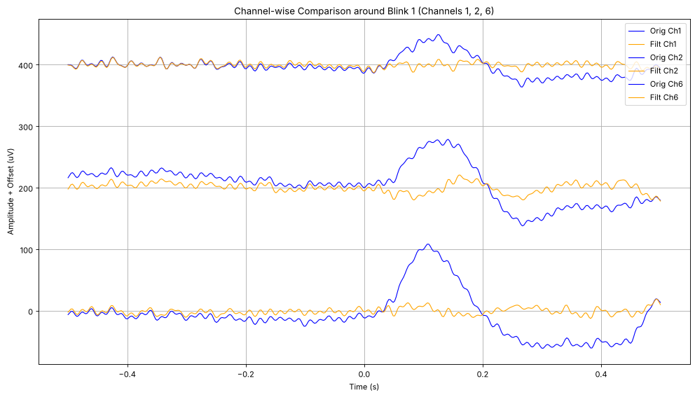

# Eye-Blink Artifact Removal from EEG with a Multichannel Wiener Filter

Removing eye-blink artifacts from 19-channel scalp EEG with a **multichannel Wiener filter (MWF)**. The filter
uses spatio-temporal correlations between channels to estimate the blink component, then subtracts it,
leaving neural activity as untouched as possible.



*Channels 1, 2 and 6 around the first annotated blink: original (blue) and after MWF filtering (orange).*

## Data

| Set | Channels | Duration | Fs | Labels |
| --- | ---: | ---: | ---: | --- |
| `Training_EEG.mat` | 19 | 24 s | 400 Hz | 8 annotated blink regions (avg. 0.9 s) |
| `Test_EEG.mat` | 19 | 242 s | 400 Hz | none |

## Method

1. **Framing**: 300-sample frames (0.75 s) with 75% overlap, mean removed per frame.
2. **Blink-frame labelling**: frames that overlap an annotated blink are "artifact" frames.
3. **Covariance estimation**: time-lagged (Hankel) covariances, with filter length L = 15, of the frontal
   electrodes Fp1 and Fp2, giving R_yy over artifact frames and R_vv over clean frames.
4. **MWF**: H = Uₙ (I − R_vv R_yy⁻¹) estimates the blink component on each channel, which is then
   subtracted.
5. **Reconstruction**: Bartlett-windowed overlap-add.
6. **Evaluation**: artifact attenuation *D_aa* and signal distortion *D_sd* over 125 ms segments around the
   blinks.

| Configuration | D_aa | D_sd |
| --- | ---: | ---: |
| Fp1 + Fp2, L = 15, frame = 300 | 27.0 | 15.6 |
| Fp1 + Fp2, L = 10, frame = 400 (best from parameter sweep) | 24.1 | 12.4 |

## Running

```bash
pip install -r requirements.txt
jupyter notebook est_Det_Final.ipynb
```

Cells 1–3 run end to end on the training data: overview plots, MWF with metrics, and before/after plots.

## Known issues

The test-set cell (cell 4) is unfinished. It labels test frames using the **training** blink indices, and it
calls `apply_blink_model` without the trained detector parameters, which are never produced in the notebook.
Finishing it needs a blink detector, e.g. thresholding the Fp1/Fp2 envelope with thresholds learned on the
training set, that supplies the artifact frames for the test recording.
